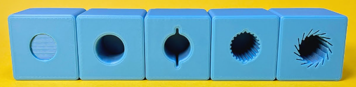
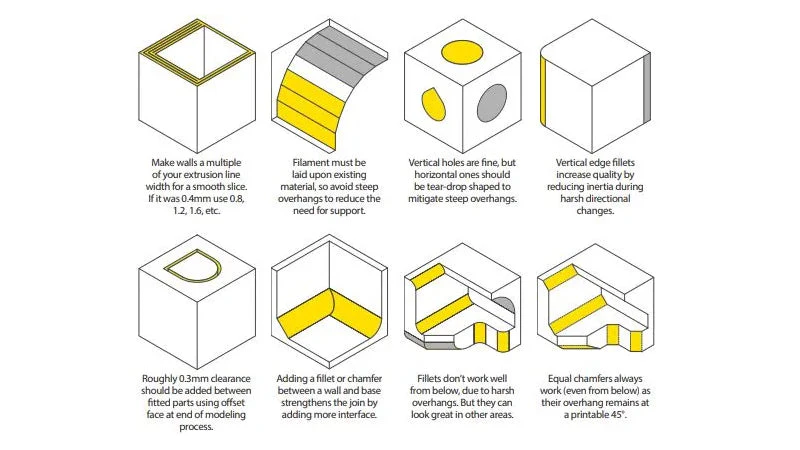

1. Generally holes need to be at least 0.4 mm larger in diameter than the object going into them
2. Some hole types 
3. Add chamfer to the entry of the holes
4. There are various features that can be added to holes to make them grip better, with constant force independent of tolerances
5. Chamfer the bottom edge of the parts by approximately 0.5-0.8 mm
6. Especially for ABS, which has large temperature expansion coefficient, make sure the bottom raft is 
sufficiently large otherwise it can come off the bed during the print.
7. Adding support material for overhangs can be replaced with chamfering, leading to less wastage
8. It's a good idea to round most sharp edges - it reduces warping, and helps optimize the tool path (reduces the required acceleration)
9. Beware of the filament material running out part-way through the print! It's OK to replace it with the same material (PLA, ABS) 
of a different color, should that happen.
10.  Auto placement in Bambu Studio does not actually always respect required clearances between the parts, especially when support material is involved. The final verification of sufficient clearances is the lack of warnings and errors during the slice process
11.  Also, the "auto rotate" feature during auto-placement is not smart enough to deduce optimal, or even correct rotation. Manual rotation is often required, based on the designer's intent

## Misc tips
