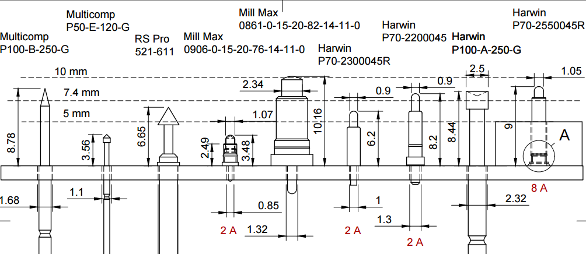

# General
1. Engage with the manufacturer _early_ when deciding on stack-up for impedance controlled board to check their laminate capabilities
2. Adding more layers is relatively cheap, adding blind and buried vias is _expensive_
3. Mind the surface finish when pad sizes get small
4. Decide on correct minimum clearances and track widths _early on_. Even more so for IS or high-current designs
5. For high-current tracks, it pays to apply the rule for the minimum width in the schematic, instead of relying on memory to set the width manually

# DFT Design For Test

1. When in doubt, add a test point
2. Majority of sprung pin test points are rated at up to 3 A, some at 9 A, but not many above that
3. It's very handy to have a side-by-side drawing of available test point sizes when deciding on the DUT height above the test jig:

# DFM Design for Manufacturing
1. In general, do not print any layers to all gerber files. Board outline should live in its own file
2. Do not include information gerber layers (say stackup table) for automated PCB quoting tools (JLCPCB, Eurocircuits) 
- it tends to confuse their back-end